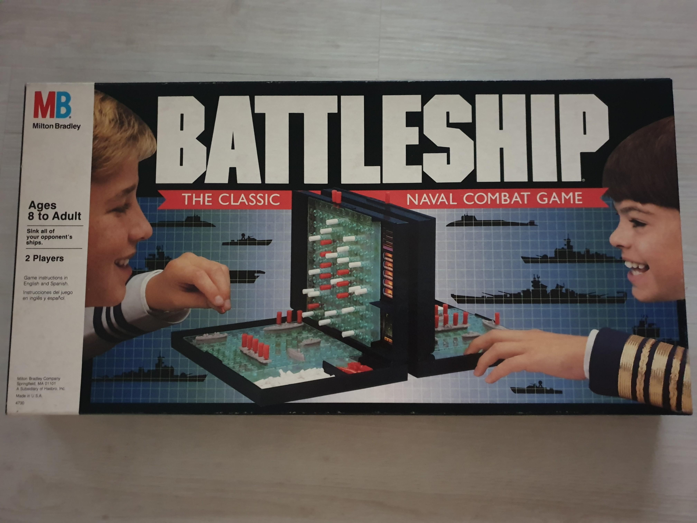

# Battleship in terminal
University pair python project. Terminal version of the board game "Battleship" seen on image below. Lets two users play against each other on the same machine, just as the classic board game.

